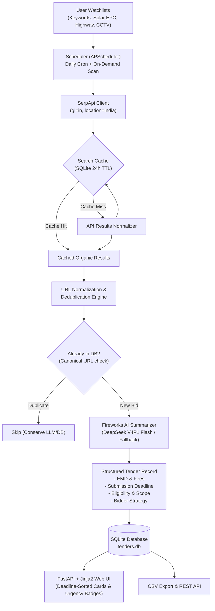

# 🎯 TenderRadar

> **Automated Indian Government Tender Discovery & Tracking Agent**  
> *Built for the SerpApi India Hackathon 2026 (Submission Deadline: October 10, 2026 at 23:59 IST)*

[](LICENSE)
[](https://www.python.org/downloads/)
[](https://serpapi.com)
[](https://fastapi.tiangolo.com/)
[]()

---

## 💡 The Core Problem & Insight

The Government of India and state agencies tender out over **₹50 Lakh Crore** annually across infrastructure, civil works, renewable energy, healthcare, and IT. However, public procurement discovery in India is critically fragmented:

* **GeM (Government e-Marketplace):** Central goods and services bids (`gem.gov.in`).
* **CPPP (Central Public Procurement Portal):** Central PSUs and ministry tenders (`eprocure.gov.in`, `etenders.gov.in`).
* **IREPS:** Indian Railways electronic procurement (`ireps.gov.in`).
* **State Procurement Portals:** Maharashtra (`mahatenders.gov.in`), Karnataka (`kppp.karnataka.gov.in`), West Bengal (`wbtenders.gov.in`), Odisha (`tendersodisha.gov.in`), etc.

Small and medium contractors (SMEs), startups, and bid consultants routinely **miss lucrative opportunities** or discover them 48 hours before cutoff because searching dozens of separate, CAPTCHA-laden, outdated portals is manual and painful.

**TenderRadar** acts as an autonomous surveillance agent: watching all Indian government tender portals via SerpApi, deduplicating bids, extracting structured eligibility and EMD requirements via an LLM pipeline, and serving them on an urgency-ranked, deadline-sorted dashboard.

---

## ⚡ How SerpApi Powers TenderRadar (The Critical Core)

Without **SerpApi**, TenderRadar simply could not exist. 

There is **no unified public API** across Indian procurement authorities. Building dozens of custom scrapers would constantly break against session tokens, CAPTCHAs, and frequent government portal redesigns. 

SerpApi’s Google Search API provides a unified, real-time discovery engine across every Indian government portal simultaneously:

### 1. Targeted Indian Government Footprint
TenderRadar constructs precise Google search queries targeting verified government domains:
```text
"{keyword}" tender (site:eprocure.gov.in OR site:gem.gov.in OR site:etenders.gov.in OR site:ireps.gov.in OR site:mahatenders.gov.in OR site:kppp.karnataka.gov.in OR site:wbtenders.gov.in OR site:tendersodisha.gov.in)
```

### 2. India-Specific Geotargeting
All SerpApi queries utilize India localization to ensure domestic procurement results:
* `engine: "google"`
* `gl: "in"` (Region: India)
* `hl: "en"`
* `location: "India"`

### 3. Credit Conservation & Free-Tier Optimization
A SerpApi free tier account includes 250 credits/month. TenderRadar is engineered to maximize every credit:
* **SQLite Search Cache:** Queries and results are hashed (SHA-256) and cached with a 24-hour TTL (`search_cache` table). Repeated scans for the same keyword within the TTL consume **0 credits**.
* **Tight Result Batches:** Scans limit result count (`num=10`), retrieving the highest-relevance bids without wasteful pagination.
* **Never Fires Unbatched Loops:** Scheduled scans run in controlled batches with deduplication before LLM summarization.
* **Offline Mock Engine:** A built-in high-fidelity mock engine generates authentic Indian tender fixtures when API keys are absent or `MOCK_SERPAPI=1`, ensuring seamless offline demos and test suites.

---

## 🔍 Search Provider: SerpApi

TenderRadar searches tender portals through SerpApi’s Google Search API:

### 1. SerpApi (Primary Provider — Built for Hackathon Evaluation)
* **Role:** Primary search provider exercising SerpApi's Google Search API.
* **Authoritative Footprint:** Searches GeM, CPPP, eTenders, IREPS, and state portals.
* **Localization:** Strict India geotargeting (`gl=in`, `hl=en`, `location=India`).
* **Credit Optimization:** 250 credits/month free tier conserved with SHA-256 SQLite caching (24h TTL) and bounded batches (`num=10`).

### 2. Resilience
* If the SerpApi call raises an exception or fails, TenderRadar falls back to simulated continuity fixtures so scans never crash. Zero human intervention is required.
* The offline mock engine pattern (`MOCK_SERPAPI=1` or unset keys) allows complete offline testing.

* If the primary provider raises an exception or fails, TenderRadar automatically tries the other provider once before falling back to simulated continuity fixtures. Zero human intervention is required.
* Both providers share the offline mock engine pattern (`MOCK_SERPAPI=1` or unset keys), allowing complete offline testing.

---

## 🤖 LLM Summarizer: Fireworks AI & DeepSeek V4P1 Flash

TenderRadar leverages **Fireworks AI** running **DeepSeek V4P1 Flash** (`accounts/fireworks/models/deepseek-v4p1-flash`) via an OpenAI-compatible endpoint:
* **Endpoint / Base URL:** `https://api.fireworks.ai/inference/v1` (configured via `FIREWORKS_BASE_URL` or `LLM_BASE_URL`)
* **Model Selection:** Verified against Fireworks AI `/models` catalog (`accounts/fireworks/models/deepseek-v4p1-flash`) for ultra-low latency, reasoning-capable procurement parsing.
* **Authentication:** Uses `FIREWORKS_API_KEY` (or legacy `LLM_API_KEY`).
* **Structured Extraction:** Directly extracts scope of work, technical eligibility, EMD amounts, tender document fees, normalized ISO submission deadlines (`YYYY-MM-DD`), and strategic bid takeaways.
* **Configurability:** Fully overridable via `FIREWORKS_API_KEY`, `FIREWORKS_BASE_URL`, and `LLM_MODEL` environment variables.
* **Offline Mock Mode:** Seamless fallback to rule-based heuristic extraction when `MOCK_LLM=1` or keys are absent.

---

## 🏗️ Architecture & Pipeline



---

## 🛠️ Key Features

1. **Watchlist CRUD & Server-Side Validation:**
   * Manage custom procurement keywords, categories, minimum contract thresholds, and state filters.
   * Server-side length and character sanitization prevents empty or abusive inputs.
2. **Strict URL Normalization & Deduplication:**
   * Government URLs often contain volatile tracking tags (`utm_*`, `ref`, `fbclid`, `gclid`) and Java servlet session parameters (`;jsessionid=...`).
   * TenderRadar normalizes URLs into a deterministic canonical format. Duplicate search hits for the exact same tender are strictly deduplicated at the database constraint level.
3. **LLM Summarizer Pipeline:**
   * Ingests tender snippets and RFP metadata to extract:
     * **Scope of Work:** 1-2 sentence executive summary of deliverables.
     * **Eligibility Criteria:** Turnover thresholds, vendor classification, and MSME provisions.
     * **EMD (Earnest Money Deposit) & Tender Fees:** Extracted in INR ₹ Lakhs/Crores or flagged as MSME Exempt.
     * **Submission Deadline:** Normalized to `YYYY-MM-DD` ISO format.
     * **Strategic Bid Takeaways:** Actionable advice for bidding contractors.
   * Supports any OpenAI-compatible provider (OpenAI, Groq, Ollama, OpenRouter) with an intelligent rule-based heuristic fallback that works offline without API keys.
4. **Urgency-Ranked Dashboard:**
   * Visual badges color-coded by urgency:
     * 🔴 **Urgent (<3 Days Left):** Red alert for bids requiring immediate submission.
     * 🟡 **Closing Soon (<7 Days Left):** Amber warning for upcoming deadlines.
     * 🟢 **Active (>7 Days Left):** Green for tenders with ample preparation time.
     * ⚪ **Expired:** Greyed out past bids.
     * 🔵 **Flexible / Open:** Ongoing rate contracts.
5. **One-Click CSV Export:**
   * Export all filtered tenders directly into a CSV spreadsheet formatted for contractor estimation teams.
6. **APScheduler Background Jobs:**
   * Runs daily automated discovery scans at a user-configured hour (default: 06:00 IST) plus instant on-demand scanning per watchlist or system-wide.

---

## 🚀 Quickstart & Installation

### 1. Prerequisites
* Python 3.10+ (tested on Python 3.12)
* `git`

### 2. Clone Repository
```bash
git clone https://github.com/your-username/tenderradar.git
cd tenderradar
```

### 3. Create & Activate Virtual Environment
```bash
python3 -m venv .venv
source .venv/bin/activate  # On Windows: .venv\Scripts\activate
```

### 4. Install Dependencies
```bash
pip install -r requirements.txt
```

### 5. Configure Environment Variables
Copy `.env.example` to `.env`:
```bash
cp .env.example .env
```
Edit `.env` (optional — TenderRadar runs out-of-the-box with built-in mock engines if no keys are provided):
```ini
# Search (SerpApi)
SEARCH_PROVIDER=serpapi
SERPAPI_API_KEY=your_serpapi_key_here
