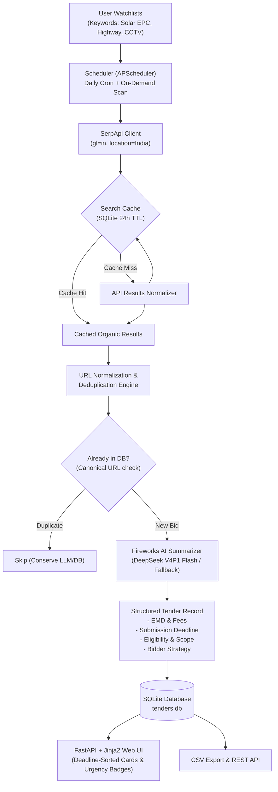
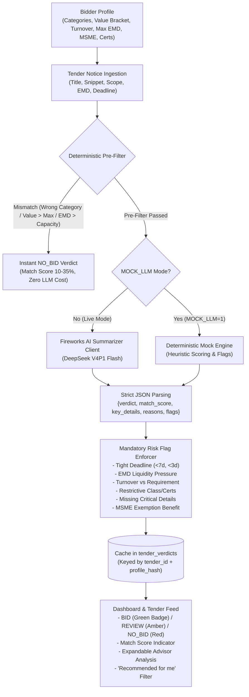

# 🎯 TenderRadar

> **Automated Indian Government Tender Discovery & Tracking Agent**  
> *Built for the SerpApi India Hackathon 2026 (Submission Deadline: October 10, 2026 at 23:59 IST)*

[](LICENSE)
[](https://www.python.org/downloads/)
[](https://serpapi.com)
[](https://fastapi.tiangolo.com/)
[]()
[]()

---

## 💡 The Core Problem & Insight

The Government of India and state agencies tender out over **₹50 Lakh Crore** annually across infrastructure, civil works, renewable energy, healthcare, and IT. However, public procurement discovery in India is critically fragmented:

* **GeM (Government e-Marketplace):** Central goods and services bids (`gem.gov.in`).
* **CPPP (Central Public Procurement Portal):** Central PSUs and ministry tenders (`eprocure.gov.in`, `etenders.gov.in`).
* **IREPS:** Indian Railways electronic procurement (`ireps.gov.in`).
* **State Procurement Portals:** Maharashtra (`mahatenders.gov.in`), Karnataka (`kppp.karnataka.gov.in`), West Bengal (`wbtenders.gov.in`), Odisha (`tendersodisha.gov.in`), etc.

Small and medium contractors (SMEs), startups, and bid consultants routinely **miss lucrative opportunities** or discover them 48 hours before cutoff because searching dozens of separate, CAPTCHA-laden, outdated portals is manual and painful.

**TenderRadar** acts as an autonomous surveillance agent: watching all Indian government tender portals via SerpApi, deduplicating bids, extracting structured eligibility and EMD requirements via an LLM pipeline, and serving them on an urgency-ranked, deadline-sorted dashboard.

---

## ⚡ How SerpApi Powers TenderRadar (The Critical Core)

Without **SerpApi**, TenderRadar simply could not exist. 

There is **no unified public API** across Indian procurement authorities. Building dozens of custom scrapers would constantly break against session tokens, CAPTCHAs, and frequent government portal redesigns. 

SerpApi’s Google Search API provides a unified, real-time discovery engine across every Indian government portal simultaneously:

### 1. Targeted Indian Government Footprint
TenderRadar constructs precise Google search queries targeting verified government domains:
```text
"{keyword}" tender (site:eprocure.gov.in OR site:gem.gov.in OR site:etenders.gov.in OR site:ireps.gov.in OR site:mahatenders.gov.in OR site:kppp.karnataka.gov.in OR site:wbtenders.gov.in OR site:tendersodisha.gov.in)
```

### 2. India-Specific Geotargeting
All SerpApi queries utilize India localization to ensure domestic procurement results:
* `engine: "google"`
* `gl: "in"` (Region: India)
* `hl: "en"`
* `location: "India"`

### 3. Credit Conservation & Free-Tier Optimization
A SerpApi free tier account includes 250 credits/month. TenderRadar is engineered to maximize every credit:
* **SQLite Search Cache:** Queries and results are hashed (SHA-256) and cached with a 24-hour TTL (`search_cache` table). Repeated scans for the same keyword within the TTL consume **0 credits**.
* **Tight Result Batches:** Scans limit result count (`num=10`), retrieving the highest-relevance bids without wasteful pagination.
* **Never Fires Unbatched Loops:** Scheduled scans run in controlled batches with deduplication before LLM summarization.
* **Offline Mock Engine:** A built-in high-fidelity mock engine generates authentic Indian tender fixtures when API keys are absent or `MOCK_SERPAPI=1`, ensuring seamless offline demos and test suites.

---

## 🔍 Search Provider: SerpApi

TenderRadar searches tender portals through SerpApi’s Google Search API:

### 1. SerpApi (Primary Provider — Built for Hackathon Evaluation)
* **Role:** Primary search provider exercising SerpApi's Google Search API.
* **Authoritative Footprint:** Searches GeM, CPPP, eTenders, IREPS, and state portals.
* **Localization:** Strict India geotargeting (`gl=in`, `hl=en`, `location=India`).
* **Credit Optimization:** 250 credits/month free tier conserved with SHA-256 SQLite caching (24h TTL) and bounded batches (`num=10`).

### 2. Resilience
* If the SerpApi call raises an exception or fails, TenderRadar falls back to simulated continuity fixtures so scans never crash. Zero human intervention is required.
* The offline mock engine pattern (`MOCK_SERPAPI=1` or unset keys) allows complete offline testing.


---

## 🤖 LLM Summarizer: Fireworks AI & DeepSeek V4P1 Flash

TenderRadar leverages **Fireworks AI** running **DeepSeek V4P1 Flash** (`accounts/fireworks/models/deepseek-v4p1-flash`) via an OpenAI-compatible endpoint:
* **Endpoint / Base URL:** `https://api.fireworks.ai/inference/v1` (configured via `FIREWORKS_BASE_URL` or `LLM_BASE_URL`)
* **Model Selection:** Verified against Fireworks AI `/models` catalog (`accounts/fireworks/models/deepseek-v4p1-flash`) for ultra-low latency, reasoning-capable procurement parsing.
* **Authentication:** Uses `FIREWORKS_API_KEY` (or legacy `LLM_API_KEY`).
* **Structured Extraction:** Directly extracts scope of work, technical eligibility, EMD amounts, tender document fees, normalized ISO submission deadlines (`YYYY-MM-DD`), and strategic bid takeaways.
* **Configurability:** Fully overridable via `FIREWORKS_API_KEY`, `FIREWORKS_BASE_URL`, and `LLM_MODEL` environment variables.
* **Offline Mock Mode:** Seamless fallback to rule-based heuristic extraction when `MOCK_LLM=1` or keys are absent.

---

## 🏗️ Architecture & Pipeline



---

## 🛠️ Key Features

1. **Watchlist CRUD & Server-Side Validation:**
   * Manage custom procurement keywords, categories, minimum contract thresholds, and state filters.
   * Server-side length and character sanitization prevents empty or abusive inputs.
2. **Strict URL Normalization & Deduplication:**
   * Government URLs often contain volatile tracking tags (`utm_*`, `ref`, `fbclid`, `gclid`) and Java servlet session parameters (`;jsessionid=...`).
   * TenderRadar normalizes URLs into a deterministic canonical format. Duplicate search hits for the exact same tender are strictly deduplicated at the database constraint level.
3. **LLM Summarizer Pipeline:**
   * Ingests tender snippets and RFP metadata to extract:
     * **Scope of Work:** 1-2 sentence executive summary of deliverables.
     * **Eligibility Criteria:** Turnover thresholds, vendor classification, and MSME provisions.
     * **EMD (Earnest Money Deposit) & Tender Fees:** Extracted in INR ₹ Lakhs/Crores or flagged as MSME Exempt.
     * **Submission Deadline:** Normalized to `YYYY-MM-DD` ISO format.
     * **Strategic Bid Takeaways:** Actionable advice for bidding contractors.
   * Supports any OpenAI-compatible provider (OpenAI, Groq, Ollama, OpenRouter) with an intelligent rule-based heuristic fallback that works offline without API keys.
4. **Urgency-Ranked Dashboard:**
   * Visual badges color-coded by urgency:
     * 🔴 **Urgent (<3 Days Left):** Red alert for bids requiring immediate submission.
     * 🟡 **Closing Soon (<7 Days Left):** Amber warning for upcoming deadlines.
     * 🟢 **Active (>7 Days Left):** Green for tenders with ample preparation time.
     * ⚪ **Expired:** Greyed out past bids.
     * 🔵 **Flexible / Open:** Ongoing rate contracts.
5. **One-Click CSV Export:**
   * Export all filtered tenders directly into a CSV spreadsheet formatted for contractor estimation teams.
6. **APScheduler Background Jobs:**
   * Runs daily automated discovery scans at a user-configured hour (default: 06:00 IST) plus instant on-demand scanning per watchlist or system-wide.

---

## 🚀 Quickstart & Installation

### 1. Prerequisites
* Python 3.10+ (tested on Python 3.12)
* `git`

### 2. Clone Repository
```bash
git clone https://github.com/your-username/tenderradar.git
cd tenderradar
```

### 3. Create & Activate Virtual Environment
```bash
python3 -m venv .venv
source .venv/bin/activate  # On Windows: .venv\Scripts\activate
```

### 4. Install Dependencies
```bash
pip install -r requirements.txt
```

### 5. Configure Environment Variables
Copy `.env.example` to `.env`:
```bash
cp .env.example .env
```ini
# Search (SerpApi - Primary Sponsor Provider)
SERPAPI_API_KEY=your_serpapi_key_here

# Fireworks AI / DeepSeek V4P1 Flash
FIREWORKS_API_KEY=your_fireworks_api_key_here
LLM_MODEL=accounts/fireworks/models/deepseek-v4p1-flash

# Optional offline mock flags (default auto-detected when keys are absent)
MOCK_SERPAPI=0
MOCK_LLM=0
```

### 6. Run Application
```bash
uvicorn app.main:app --host 0.0.0.0 --port 8000 --reload
```
Open **http://localhost:8000** in your browser to access the dashboard.

---

## 🎯 Headline Differentiator: Bid/No-Bid Advisor Engine

The headline differentiator of TenderRadar is the **Autonomous Bid/No-Bid Advisor**.

Contractors and SMEs in India typically spend hours reading 50-page RFPs only to realize in week 2 that they do not meet the minimum annual turnover requirement or cannot arrange the required ₹25 Lakh EMD liquidity.

The **Bid Advisor** solves this end-to-end:
The contractor configures their organizational capabilities once (or uses pre-filled defaults), and TenderRadar **automatically picks matching tenders, computes match scores (0-100), flags risks, and recommends BID, REVIEW, or NO-BID with transparent reasoning**.



### 1. Bidder Profile (`/profile`, SQLite table `bidder_profile`)
Single active, fully editable organizational profile stored in SQLite:
* `company_name`: Contractor or firm legal entity.
* `categories`: Target domain competencies (e.g. `["Solar EPC", "Electrical Infrastructure", "Civil Construction", "CCTV Surveillance"]`).
* `min_contract_value` & `max_contract_value`: Target contract size bracket in INR (e.g. ₹25 Lakhs to ₹5 Crores).
* `annual_turnover`: Audited annual turnover in INR for qualification benchmarking.
* `max_emd_capacity`: Maximum liquid capital available for Earnest Money Deposits.
* `msme_registered`: Flags eligibility for statutory EMD and tender fee exemptions under the Indian Public Procurement Policy.
* `startup_registered`: DPIIT startup recognition for prior experience & turnover waivers.
* `certifications`: Technical licenses and contractor classifications (e.g. `ISO 9001:2015`, `Class A Electrical`).
* `preferred_states`: Primary operational regions (e.g. `Maharashtra`, `Gujarat`, `Delhi`, `All India`).

### 2. Multi-Stage Advisory Pipeline
1. **Deterministic Pre-Filter (`app/bid_advisor.py`):**
   * **Category Keyword Matching:** Checks whether any bidder category matches the tender title, snippet, scope, or watchlist.
   * **Estimated Contract Value:** Parses Indian currency notation (Crores, Lakhs, commas) from the notice. If present, verifies `min <= value <= max`. If unstated in the notice, marks as `"Unknown"` and passes.
   * **EMD Liquidity & MSME Exemption:** Extracts EMD requirement. If contractor is MSME-registered and tender notes MSME exemption or is published on GeM, EMD is waived. Otherwise, verifies `EMD <= max_emd_capacity`.
2. **DeepSeek V4P1 Flash LLM Decision (`app/summarizer.py`):**
   * Reuses the single Fireworks AI client.
   * DeepSeek is prompted with the tender details + bidder profile and responds strictly in structured JSON.
   * Evaluates technical qualifications, site conditions, feasibility, and contractor fit.
3. **Mandatory Risk & Opportunity Flags:**
   * ⏰ **Tight Deadline (<7 days / <3 days):** Flags critical preparation risk for imminent bid deadlines.
   * 💰 **EMD Near / Over Capacity:** Flags significant working capital lockup (>80% capacity) or disqualification.
   * 📊 **Turnover Requirements:** Compares tender minimum turnover thresholds against contractor's audited turnover.
   * 📜 **Restrictive Eligibility:** Detects requirements such as Class 1 contractor only, proprietary OEM certificates, or joint venture restrictions.
   * 🔍 **Missing Critical Info:** Highlights unstated contract values, missing submission deadlines, or unspecified EMD fees.
   * 🏛️ **MSME Exemption Benefit:** Identifies applicability of EMD / document fee waivers under Indian procurement rules.
4. **Deterministic Profile Hashing & Cache Invalidation:**
   * Verdicts are saved in `tender_verdicts` keyed by `(tender_id, profile_hash)`.
   * When a contractor updates their profile in the UI or API, `profile_hash` changes immediately: subsequent views recalculate recommendations seamlessly without manual cache clearing.
5. **Offline Mock Mode (`MOCK_LLM=1`):**
   * 100% deterministic rule-based evaluation engine running offline with zero API calls.

### 3. REST API & UI Integration
* `GET /api/profile`: Retrieves current active bidder profile.
* `PUT /api/profile`: Validates (`min <= max`, non-negative) and updates bidder profile.
* `GET /api/tenders?recommended=true`: Filters the tender feed to return only `BID`-recommended tenders.
* `GET /api/tenders/{id}/verdict`: Returns structured advisory assessment JSON.
* **UI Features:**
  * **Profile Setup Page (`/profile`):** Pre-filled form with sensible Indian contractor defaults and validation guards.
  * **Interactive Tender Feed (`/`):** Color-coded verdict badges (🟢 `BID`, 🟡 `REVIEW`, 🔴 `NO_BID`) + match score pill + one-click expandable advisor detail panel.
  * **"Recommended for me" Filter Toggle:** Instantly filters the dashboard to tenders recommended for the active profile.
  * **Tender Detail Page (`/tenders/{id}`):** Full-page advisory card displaying key details, decision rationale, and severity-colored risk flags.

---

## 📌 Saved Tenders (Bookmark + Review Later)

Contractors often need to flag high-potential tenders, consult internal engineering teams, and draft queries before cutoff. TenderRadar provides a dedicated **Saved Tenders** subsystem:

* **Persistent SQLite Storage:** Table `saved_tenders` stores `(tender_id, saved_at, notes)` with foreign key cascade on tender deletion. State survives server restarts.
* **Dedicated Saved Page (`/saved`):**
  * Displays bookmarked tenders ordered newest-first by `saved_at`.
  * Inline interactive notes editor for private bidding strategy notes (e.g. JV partners, pre-bid queries).
  * Direct Unsave button and "Open Official Portal" link on every card.
  * Polished empty state when no tenders are bookmarked.
* **REST API Endpoints:**
  * `POST /api/tenders/{id}/save`: Bookmark a tender with optional notes in JSON body `{"notes": "..."}`.
  * `DELETE /api/tenders/{id}/save`: Remove a bookmark.
  * `GET /api/saved`: List all saved tenders with full details and advisory verdicts, sorted newest-first.
  * `PATCH /api/tenders/{id}/notes`: Update user review notes for a saved tender.
* **One-Click UI Controls:** Save / Unsave button on every tender card in the dashboard feed and on the tender detail view.

---

## 🔗 "Open Official Tender Portal" Link Correctness

Government procurement portals in India (CPPP `eprocure.gov.in`, `etenders.gov.in`, GeM `gem.gov.in`, state NIC instances) use specialized servlet routing, parameter encoding, and session states:

* **Architecture Decision:** `canonical_url` is strictly used for deduplication (stripping volatile session tokens and tracking tags), while the portal button utilizes `select_portal_url` to guarantee users reach the actual tender document page.
* **Robust URL Selection (`app/normalizer.py`):**
  1. **HTML Entity Unescaping:** Automatically fixes Google snippet artifact entities like `&amp;` -> `&` (e.g. on `etenders.hry.nic.in`).
  2. **Search Redirect Unwrapping:** Extracts destination target URLs from Google/SerpApi redirects (`google.com/url?q=...`), bypassing search redirect hops.
  3. **Parameter Preservation:** Retains crucial routing parameters (`component=$DirectLink`, `page=FrontEndTenderDetails`, `service=direct`, `sp=...`) required by Central and State NIC systems.
  4. **Fallback Safety:** Gracefully falls back to `canonical_url` if the original link is absent or malformed.
* **Real Verification in Database:** Verified across live Indian government tenders returning HTTP 200 on official domains (`etenders.gov.in`, `eprocure.gov.in`, `etenders.hry.nic.in`).

---

## 🎨 Y Combinator Inspired Minimalist UI Theme

TenderRadar features a clean, professional theme inspired by **Y Combinator** and Hacker News:
* **Off-White Canvas:** Clean `#f6f6ef` background providing high contrast and low visual fatigue for contractor workflows.
* **YC Orange Accents:** `#f26625` primary buttons, accents, and brand badge.
* **Typography:** System sans-serif stack (`-apple-system, BlinkMacSystemFont, "Segoe UI", Roboto`), dark charcoal headings (`#222222`), and clear visual hierarchy.
* **Subtle Borders & Generous Whitespace:** Replaced heavy shadows with subtle borders (`1px solid #e5e5dc`), clean cards, and generous spacing.
* **Complete Product Polish:**
  * Consistent sticky navbar with logo mark, Dashboard, Saved, Profile, Watchlists, and Scans links.
  * Interactive loading feedback on all scan buttons (`⚡ Scanning...`).
  * Responsive layout designed to adapt fluidly down to mobile viewports without horizontal breakage.
  * Polished empty states across dashboard, saved items, and scan logs.

---

## 🧪 Testing & Quality Gates

Run the comprehensive pytest suite in offline mock mode (no API keys required):

```bash
MOCK_SERPAPI=1 MOCK_LLM=1 pytest -v
```

The test suite covers (74 tests passing):
* ✅ Watchlist CRUD and input validation.
* ✅ URL normalization and canonical deduplication.
* ✅ Portal button URL selection logic (`select_portal_url`) with redirect unwrapping & entity decoding.
* ✅ Saved tenders database CRUD, note editing, newest-first ordering, and SQLite restart persistence.
* ✅ Saved tenders REST API (`POST`, `DELETE`, `GET /api/saved`, `PATCH /notes`).
* ✅ Search cache TTL and SerpApi credit conservation.
* ✅ Bidder profile CRUD, range validation (`min <= max`, non-negative), and stable hashing.
* ✅ Deterministic pre-filter (category match, value bracket, EMD capacity).
* ✅ Strict JSON schema validation for BidVerdict models.
* ✅ Mock-mode verdict determinism (identical results across runs).
* ✅ Cache invalidation on profile change.
* ✅ "Recommended for me" filtering across Web UI and REST API.
* ✅ Web route rendering (`/`, `/saved`, `/profile`, `/watchlists`, `/scans`, `/tenders/{id}`) and portal button hrefs.
* ✅ Vercel serverless adaptation (read-only SQLite fallback and background scheduler suppression).

---

## 🚀 Deploying to Vercel (Serverless)

TenderRadar can be deployed to Vercel using the official Python Serverless Runtime (`@vercel/python`).

### Architecture Overview on Serverless
1. **Entry Point:** `api/index.py` exposes the FastAPI ASGI application directly to Vercel functions.
2. **Bundled Database:** `vercel.json` bundles a pre-seeded, read-only copy of `data/tenders.db` containing Indian government tenders with computed BidAdvisor verdicts.
3. **Read-Only SQLite Graceful Fallback:** In serverless execution, SQLite operates in read-only mode (`?mode=ro`). Dynamic user actions (such as bookmarking saved tenders, updating notes, editing organizational profiles, or trigger logs) automatically fallback to in-memory storage so the app never throws database write errors.
4. **Disabled Background Scheduler:** The APScheduler lifespan task is automatically disabled on Vercel (`is_vercel`), avoiding background thread leaks in serverless functions.

### Environment Variables on Vercel Dashboard

Configure the following environment variables in your Vercel Project Settings (**Settings → Environment Variables**):

| Variable | Required | Default | Description |
|---|---|---|---|
| `SERPAPI_API_KEY` | Optional (for live scans) | `""` | SerpApi API key from [serpapi.com](https://serpapi.com). Used for live multi-portal Indian tender searches and PDF document discovery. |
| `FIREWORKS_API_KEY` | Optional (for live LLM) | `""` | Fireworks AI key from [fireworks.ai](https://fireworks.ai). Powers DeepSeek V4P1 Flash for automated tender summarization, eligibility extraction, and BidAdvisor scoring. |
| `MOCK_SERPAPI` | Optional | `true` (in vercel.json) | Set to `true` to use the built-in offline mock search engine (zero SerpApi credits consumed). Set to `false` when using a live `SERPAPI_API_KEY`. |
| `MOCK_LLM` | Optional | `true` (in vercel.json) | Set to `true` for deterministic offline LLM summaries and BidAdvisor verdicts. Set to `false` when using a live `FIREWORKS_API_KEY`. |

> **Security Note:** Never hardcode API keys in repository source code or `vercel.json`. Always set sensitive tokens in the Vercel dashboard.

### Deploying via Vercel CLI
```bash
# 1. Install Vercel CLI (if not already installed)
npm install -g vercel

# 2. Deploy to Production
vercel --prod
```


