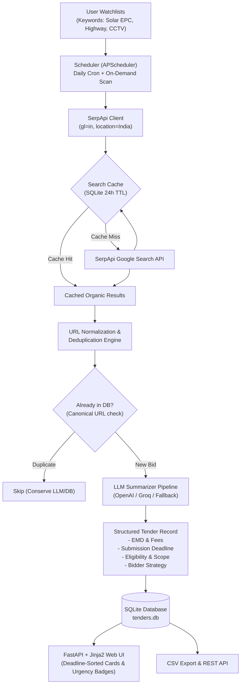

# 🎯 TenderRadar

> **Automated Indian Government Tender Discovery & Tracking Agent**  
> *Built for the SerpApi India Hackathon 2026 (Submission Deadline: October 10, 2026 at 23:59 IST)*

[](LICENSE)
[](https://www.python.org/downloads/)
[](https://serpapi.com)
[](https://fastapi.tiangolo.com/)
[]()

---

## 💡 The Core Problem & Insight

The Government of India and state agencies tender out over **₹50 Lakh Crore** annually across infrastructure, civil works, renewable energy, healthcare, and IT. However, public procurement discovery in India is critically fragmented:

* **GeM (Government e-Marketplace):** Central goods and services bids (`gem.gov.in`).
* **CPPP (Central Public Procurement Portal):** Central PSUs and ministry tenders (`eprocure.gov.in`, `etenders.gov.in`).
* **IREPS:** Indian Railways electronic procurement (`ireps.gov.in`).
* **State Procurement Portals:** Maharashtra (`mahatenders.gov.in`), Karnataka (`kppp.karnataka.gov.in`), West Bengal (`wbtenders.gov.in`), Odisha (`tendersodisha.gov.in`), etc.

Small and medium contractors (SMEs), startups, and bid consultants routinely **miss lucrative opportunities** or discover them 48 hours before cutoff because searching dozens of separate, CAPTCHA-laden, outdated portals is manual and painful.

**TenderRadar** acts as an autonomous surveillance agent: watching all Indian government tender portals via SerpApi, deduplicating bids, extracting structured eligibility and EMD requirements via an LLM pipeline, and serving them on an urgency-ranked, deadline-sorted dashboard.

---

## ⚡ How SerpApi Powers TenderRadar (The Critical Core)

Without **SerpApi**, TenderRadar simply could not exist. 

There is **no unified public API** across Indian procurement authorities. Building dozens of custom scrapers would constantly break against session tokens, CAPTCHAs, and frequent government portal redesigns. 

SerpApi’s Google Search API provides a unified, real-time discovery engine across every Indian government portal simultaneously:

### 1. Targeted Indian Government Footprint
TenderRadar constructs precise Google search queries targeting verified government domains:
```text
"{keyword}" tender (site:eprocure.gov.in OR site:gem.gov.in OR site:etenders.gov.in OR site:ireps.gov.in OR site:mahatenders.gov.in OR site:kppp.karnataka.gov.in OR site:wbtenders.gov.in OR site:tendersodisha.gov.in)
```

### 2. India-Specific Geotargeting
All SerpApi queries utilize India localization to ensure domestic procurement results:
* `engine: "google"`
* `gl: "in"` (Region: India)
* `hl: "en"`
* `location: "India"`

### 3. Credit Conservation & Free-Tier Optimization
A SerpApi free tier account includes 250 credits/month. TenderRadar is engineered to maximize every credit:
* **SQLite Search Cache:** Queries and results are hashed (SHA-256) and cached with a 24-hour TTL (`search_cache` table). Repeated scans for the same keyword within the TTL consume **0 credits**.
* **Tight Result Batches:** Scans limit result count (`num=10`), retrieving the highest-relevance bids without wasteful pagination.
* **Never Fires Unbatched Loops:** Scheduled scans run in controlled batches with deduplication before LLM summarization.
* **Offline Mock Engine:** A built-in high-fidelity mock engine generates authentic Indian tender fixtures when API keys are absent or `MOCK_SERPAPI=1`, ensuring seamless offline demos and test suites.

---

## 🏗️ Architecture & Pipeline



---

## 🛠️ Key Features

1. **Watchlist CRUD & Server-Side Validation:**
   * Manage custom procurement keywords, categories, minimum contract thresholds, and state filters.
   * Server-side length and character sanitization prevents empty or abusive inputs.
2. **Strict URL Normalization & Deduplication:**
   * Government URLs often contain volatile tracking tags (`utm_*`, `ref`, `fbclid`, `gclid`) and Java servlet session parameters (`;jsessionid=...`).
   * TenderRadar normalizes URLs into a deterministic canonical format. Duplicate search hits for the exact same tender are strictly deduplicated at the database constraint level.
3. **LLM Summarizer Pipeline:**
   * Ingests tender snippets and RFP metadata to extract:
     * **Scope of Work:** 1-2 sentence executive summary of deliverables.
     * **Eligibility Criteria:** Turnover thresholds, vendor classification, and MSME provisions.
     * **EMD (Earnest Money Deposit) & Tender Fees:** Extracted in INR ₹ Lakhs/Crores or flagged as MSME Exempt.
     * **Submission Deadline:** Normalized to `YYYY-MM-DD` ISO format.
     * **Strategic Bid Takeaways:** Actionable advice for bidding contractors.
   * Supports any OpenAI-compatible provider (OpenAI, Groq, Ollama, OpenRouter) with an intelligent rule-based heuristic fallback that works offline without API keys.
4. **Urgency-Ranked Dashboard:**
   * Visual badges color-coded by urgency:
     * 🔴 **Urgent (<3 Days Left):** Red alert for bids requiring immediate submission.
     * 🟡 **Closing Soon (<7 Days Left):** Amber warning for upcoming deadlines.
     * 🟢 **Active (>7 Days Left):** Green for tenders with ample preparation time.
     * ⚪ **Expired:** Greyed out past bids.
     * 🔵 **Flexible / Open:** Ongoing rate contracts.
5. **One-Click CSV Export:**
   * Export all filtered tenders directly into a CSV spreadsheet formatted for contractor estimation teams.
6. **APScheduler Background Jobs:**
   * Runs daily automated discovery scans at a user-configured hour (default: 06:00 IST) plus instant on-demand scanning per watchlist or system-wide.

---

## 🚀 Quickstart & Installation

### 1. Prerequisites
* Python 3.10+ (tested on Python 3.12)
* `git`

### 2. Clone Repository
```bash
git clone https://github.com/your-username/tenderradar.git
cd tenderradar
```

### 3. Create & Activate Virtual Environment
```bash
python3 -m venv .venv
source .venv/bin/activate  # On Windows: .venv\Scripts\activate
```

### 4. Install Dependencies
```bash
pip install -r requirements.txt
```

### 5. Configure Environment Variables
Copy `.env.example` to `.env`:
```bash
cp .env.example .env
```
Edit `.env` (optional — TenderRadar runs out-of-the-box with built-in mock engines if no keys are provided):
```ini
SERPAPI_API_KEY=your_serpapi_key_here
LLM_API_KEY=your_openai_or_groq_key_here
LLM_BASE_URL=https://api.openai.com/v1
LLM_MODEL=gpt-4o-mini
```

### 6. Run the Application
```bash
uvicorn app.main:app --reload --host 0.0.0.0 --port 8000
```
Open your browser at **`http://localhost:8000`**.

---

## 🧪 Running Tests (Zero API Keys Required)

All tests run completely offline using built-in mock clients. Real external APIs are never hit in tests:

```bash
pytest
```

Expected output:
```text
tests/test_db.py .....                                                   [ 13%]
tests/test_normalizer.py .......                                         [ 32%]
tests/test_routes.py ............                                        [ 64%]
tests/test_scheduler.py ..                                               [ 70%]
tests/test_serpapi.py ....                                               [ 81%]
tests/test_summarizer.py .......                                         [100%]

============================== 37 passed in 5.81s ==============================
```

---

## 📂 Project Structure

```text
tenderradar/
├── LICENSE                 # Apache-2.0 License
├── README.md               # Architecture, SerpApi usage, and setup guide
├── DEMO_SCRIPT.md          # Timed demo video shot list (<3 min)
├── requirements.txt        # Python package dependencies
├── .env.example            # Environment variable template
├── .gitignore              # Git ignore rules (.env, *.db, pycache)
├── app/
│   ├── __init__.py         # Package root
│   ├── config.py           # Settings and environment configuration
│   ├── db.py               # SQLite store, WAL mode, CRUD, search cache
│   ├── models.py           # Pydantic schemas, validation, UrgencyStatus
│   ├── normalizer.py       # Canonical URL deduplication & portal detection
│   ├── serpapi_client.py   # SerpApi search client, query builder, mock engine
│   ├── summarizer.py       # LLM pipeline (OpenAI-compatible + heuristic fallback)
│   ├── scheduler.py        # APScheduler daily cron and scan manager
│   ├── main.py             # FastAPI app, Jinja2 UI routes, CSV export, REST API
│   ├── static/
│   │   ├── css/style.css   # Responsive contractor dashboard stylesheet
│   │   └── js/app.js       # Client-side UX helpers & scan indicators
│   └── templates/
│       ├── base.html       # Base layout with navbar, alerts, footer
│       ├── dashboard.html  # Deadline-sorted tender cards & urgency badges
│       ├── watchlists.html # Watchlist keyword management UI
│       ├── tender_detail.html # Comprehensive tender breakdown & portal links
│       └── scans.html      # Scan audit log and scheduler monitor
└── tests/
    ├── __init__.py
    ├── test_normalizer.py  # Canonical URL normalization & deduplication tests
    ├── test_serpapi.py     # SerpApi query builder, caching, mock engine tests
    ├── test_summarizer.py  # LLM summarizer & regex entity extraction tests
    ├── test_db.py          # SQLite database CRUD & dedupe constraint tests
    ├── test_scheduler.py   # Scan manager orchestration & dedupe tests
    └── test_routes.py      # FastAPI UI, CSV export, and REST API tests
```

---

## 📋 REST API Reference

For headless integrations, TenderRadar exposes standard REST endpoints:

| Endpoint | Method | Description |
|---|---|---|
| `/api/tenders` | `GET` | List discovered tenders (supports `portal`, `urgency`, `search`, `sort_by`, `sort_order`). |
| `/api/tenders/{id}` | `GET` | Retrieve single tender with full AI extraction. |
| `/api/watchlists` | `GET` | List all configured watchlists. |
| `/api/watchlists` | `POST` | Create a new watchlist keyword. |
| `/api/watchlists/{id}` | `PUT` | Update watchlist category, threshold, or active status. |
| `/api/watchlists/{id}` | `DELETE` | Delete watchlist. |
| `/api/scan` | `POST` | Trigger full scan or single watchlist scan (`{"watchlist_id": 1}`). |
| `/api/scan/status` | `GET` | View current scan manager state. |
| `/api/stats` | `GET` | Retrieve high-level dashboard metrics. |
| `/export/csv` | `GET` | Download tender view as a CSV spreadsheet. |

---

## 🤖 Disclosure of AI Tools Used

In accordance with hackathon rules and transparency guidelines:
* **Google Antigravity / Gemini 3.8 Flash** was utilized as an AI pair programming assistant for initial boilerplate generation, test scaffolding, and regex refinement.
* The application design, domain-specific Indian procurement logic (GeM/CPPP/IREPS portal footprints, EMD/Tender fee parsing), SerpApi caching architecture, and codebase implementation were built and verified by the author.

---

## 📄 License

This project is licensed under the **Apache License 2.0** — see the [LICENSE](LICENSE) file for details.
